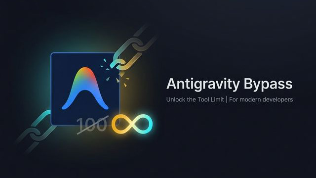

<h1 align="center">Antigravity Bypass — MCP Tool Limit Patch</h1>

<p align="center">
  
</p>

---

<p align="center">
  <a href="https://go.dev/"></a>
  <a href="README.md#supported-platforms"></a>
  <a href="LICENSE"></a>
  <a href="https://github.com/Futureppo/antigravity_bypass/releases"></a>
</p>

<p align="center">
  <b>English</b> | <a href="README_zh.md">简体中文</a>
</p>

> Google Antigravity MCP tool limit patch — IDE 2.5.5 / 2.7.0 / 2.8.0, desktop 2.13.0 / 2.33.0, and CLI 1.5.x

Antigravity Bypass raises recognized local **Model Context Protocol (MCP)** tool count limits to **8192**. IDE **2.5.5** has two **512**-tool checks; IDE **2.7.0 / 2.8.0** (shared backend 1.5.10 / 1.5.13), the desktop app **2.13.0 / 2.33.0**, and the CLI **1.5.10 / 1.5.13** have two **800**-tool checks. This tool locates them through the tool-count error string references and control flow. If both checks cannot be identified, it exits without modifying files. None of these versions needs a frontend patch.

Supports **Antigravity IDE 2.5.5 / 2.7.0 / 2.8.0**, the **desktop app 2.13.0 / 2.33.0** on Windows, Linux, and macOS (x64 and ARM64), and the **Antigravity CLI 1.5.10 / 1.5.13** (x64 and ARM64). IDE 2.7.0/2.8.0 and the IDE extensions use the shared `~/.gemini/bin/agy` backend, so patching the IDE or CLI changes that same shared file. It changes local checks only; model service limits on tool counts, context, or request sizes still apply.

**For the full reverse engineering write-up, see the blog post: [From an Error Message to Two Patches: Reversing the MCP Tool Limit in Antigravity IDE](https://blog.futureppo.top/posts/antigravity/)**

## Disclaimer

This project is for educational and research purposes only. Any consequences of using this tool are the sole responsibility of the user.

## Usage

### Download

Head to [Releases](https://github.com/Futureppo/antigravity_bypass/releases) to download the executable for your platform. Run it and follow the menu to patch or restore.

Release **v2.1.0** supports IDE 2.5.5 only. IDE 2.7.0/2.8.0, desktop, CLI, ARM64, and the latest matching rules require a build from the updated source below; the executable must recognize `--client cli`.

### Build from Source

```bash
# Clone the repository
git clone https://github.com/Futureppo/antigravity_bypass.git
cd antigravity_bypass

# Build for current platform
go build -ldflags="-s -w" -o antigravity_bypass .

# Cross-compile for other platforms
GOOS=linux   GOARCH=amd64 go build -ldflags="-s -w" -o antigravity_bypass_linux_x64 .
GOOS=linux   GOARCH=arm64 go build -ldflags="-s -w" -o antigravity_bypass_linux_arm64 .
GOOS=darwin  GOARCH=amd64 go build -ldflags="-s -w" -o antigravity_bypass_mac_x64 .
GOOS=darwin  GOARCH=arm64 go build -ldflags="-s -w" -o antigravity_bypass_mac_arm64 .
GOOS=windows GOARCH=amd64 go build -ldflags="-s -w" -o antigravity_bypass_win_x64.exe .
GOOS=windows GOARCH=arm64 go build -ldflags="-s -w" -o antigravity_bypass_win_arm64.exe .
```

### Custom Installation Path

If automatic detection fails, specify the installation directory via `--dir` or `ANTIGRAVITY_DIR`:

```bash
# IDE: installation root, resources/app directory, or macOS .app path
# Desktop: installation root, resources directory, or macOS .app bundle
# CLI: agy binary itself or its parent directory
ANTIGRAVITY_DIR="/path/to/Antigravity IDE" ./antigravity_bypass
```

> **Fully quit the selected Antigravity client** before patching or restoring.
> After client updates, run `--check` again before patching.

### Command-line mode

```powershell
.\antigravity_bypass.exe --client ide --check --dir "C:\Apps\Antigravity IDE"
.\antigravity_bypass.exe --client ide --patch --dir "C:\Apps\Antigravity IDE"
.\antigravity_bypass.exe --client ide --restore --dir "C:\Apps\Antigravity IDE"
```

For the desktop app **2.13.0 / 2.33.0** on Windows, Linux, or macOS:

```powershell
.\antigravity_bypass.exe --client desktop --check --dir "C:\Apps\Antigravity"
.\antigravity_bypass.exe --client desktop --patch --dir "C:\Apps\Antigravity"
.\antigravity_bypass.exe --client desktop --restore --dir "C:\Apps\Antigravity"
```

For the CLI **1.5.10 / 1.5.13**:

```powershell
.\antigravity_bypass.exe --client cli --check
.\antigravity_bypass.exe --client cli --patch
.\antigravity_bypass.exe --client cli --restore
# Or point at the binary / bin directory explicitly:
.\antigravity_bypass.exe --client cli --patch --dir "C:\Users\<user>\.gemini\bin"
```

Omit `--dir` to use automatic discovery. Without an action flag, the interactive menu is displayed. `--client` defaults to `auto`; when both IDE and desktop are discovered, select one with `--client ide`, `--client desktop`, `--client cli`, or an explicit path. `--dir` overrides `ANTIGRAVITY_DIR`; an invalid or mismatched explicit path fails without falling back to another installation. Both the new `Antigravity IDE` and legacy `Antigravity` installation names are detected.

For IDE **2.7.0 / 2.8.0**, the backend is installed on first launch at `%USERPROFILE%\.gemini\bin\agy.exe` (`~/.gemini/bin/agy` on other platforms) and is shared with the Antigravity CLI and IDE extensions. Fully quit the IDE **and any running `agy`/CLI process** before patching or restoring. If the shared backend has not been installed yet, start the IDE once and rerun the tool. Its independent auto-update can overwrite the patch; run `--check` again after a backend update.

The desktop patch changes only `bin/language_server(.exe)`. It reads `app.asar` to validate the product, version, and launcher, and leaves the archive and Electron executable unchanged. Desktop versions are accepted when the identity, launcher, and two recognized tool-count checks are present; 2.13.0 and 2.33.0 are verified.

## Supported Platforms

| Platform | Architecture | IDE verification |
| --- | --- | --- |
| Windows | x64 | 2.5.5 official package verified; 2.7.0 / 2.8.0 shared backend verified |
| Windows | ARM64 | 2.8.0 shared backend 1.5.13 verified (PE ARM64); 2.5.5 ARM64 not verified |
| Linux | x64 | 2.5.5 official package verified; 2.7.0 / 2.8.0 shared backend verified (ELF x64) |
| Linux | ARM64 | Shared backend 1.5.13 verified (ELF ARM64); IDE shell not verified |
| macOS | x64 / ARM64 | Shared backend 1.5.13 verified (Mach-O x64 / ARM64); IDE package not verified |

Verification uses extracted package files and byte comparisons; signed-in IDE/model calls have not been tested. See the [2.5.5](docs/compatibility-2.5.5.md), [2.7.0](docs/compatibility-2.7.0.md), [2.8.0](docs/compatibility-2.8.0.md), and [CLI 1.5.13](docs/compatibility-cli-1.5.13.md) notes for sources, hashes, and patch sites. Historical backend limits 100 / 128 / 512 / 800 / 114514 and 8192 are recognized, and the legacy frontend constants 100 / 114514 are handled separately. Older backends must still meet the complete reference and control-flow matching requirements, so every historical release is not guaranteed.

| Standalone desktop | Architecture | Verification |
| --- | --- | --- |
| Windows | x64 | 2.13.0 and 2.33.0: inspection, patch, repeat, exact restore, backend startup, and local frontend HTTP verified |
| Windows | ARM64 | 2.33.0: inspection, ARM64 patch, repeat, and restore verified |
| Linux | x64 / ARM64 | 2.33.0: inspection, patch, repeat, and restore verified; extensionless `language_server` layout |
| macOS | x64 / ARM64 | 2.33.0: inspection and patch verified inside `Antigravity.app/Contents/Resources` |

Desktop verification used an isolated profile without signing in. Real model requests and tool calls have not been tested. See the [desktop 2.13.0](docs/compatibility-desktop-2.13.0.md) and [desktop 2.33.0](docs/compatibility-desktop-2.33.0.md) notes. The CLI is a separate client mode; when IDE 2.7.0/2.8.0 or the IDE extensions share its backend, the same binary is patched in place.

If you encounter issues, please open an [Issue](https://github.com/Futureppo/antigravity_bypass/issues) with the relevant logs.

## FAQ

**Q: Antigravity reports `number of tools exceeds ...` or `Cannot enable more tools because it would exceed the limit of ...`?**
> These messages come from local MCP tool-count checks: the language server uses the format string `number of tools exceeds %d`, and older IDE versions also enforce a frontend limit. Run `--check` for your client to check compatibility before patching. Limits enforced by Google's model service, including its 128-tool limit where applicable, are unaffected by this patch.

**Q: "File is in use" error?**
> Make sure the selected Antigravity client is fully closed (including tray processes), or run the tool with administrator privileges.

**Q: The tool limit came back after a client update?**
> Updates overwrite patched files. Run `--check` first. If old backups do not match the new files, move the old `.backup` and `.backup.json` files elsewhere before patching again. Do not restore an older binary over an updated client. IDE 2.7.0/2.8.0 and the CLI download their shared backend independently; a backend update replaces the patched `agy` binary, so rerun the patch after it updates. Desktop 2.13.0 and 2.33.0 are verified; other versions are accepted only when their identity, launcher, and checks are recognized.

**Q: "Tool limit signature not found"?**
> The code structure may differ. Include the `--check` output, client type, version, OS, and architecture in an Issue. IDE 2.5.5, IDE 2.7.0/2.8.0, desktop 2.13.0/2.33.0, and CLI 1.5.x needing no frontend patch is expected. For IDE 2.7.0/2.8.0, start the IDE once so `~/.gemini/bin/agy` is installed before running the tool.

**Q: How do I restore the original files?**
> Patching creates `.backup` files and `.backup.json` checksum records. Select "Restore backups" or use `--restore` with the same client/path. Files are restored only when their checksums match the recorded state; both backup files are then removed. Older backups without checksum records require manual restoration after confirming the client version.

**Q: Already used the old patcher on 2.5.5?**
> The old signature can match unrelated string-processing instructions. Restore matching original files or reinstall the official 2.5.5 package before using this version.

## License

[AGPL-3.0](LICENSE)
