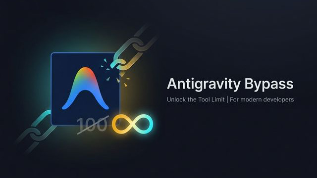

<h1 align="center">Antigravity Bypass — MCP 工具数量限制修补</h1>

<p align="center">
  
</p>

---

<p align="center">
  <a href="https://go.dev/"></a>
  <a href="README_zh.md#支持平台"></a>
  <a href="LICENSE"></a>
  <a href="https://github.com/Futureppo/antigravity_bypass/releases"></a>
</p>

<p align="center">
  <a href="README.md">English</a> | <b>简体中文</b>
</p>

> Google Antigravity MCP 工具数量限制修补 — 支持 IDE 2.5.5 / 2.7.0 / 2.8.0、桌面版 2.13.0 / 2.33.0、CLI 1.5.x

Antigravity Bypass 将可识别的本地 **MCP（Model Context Protocol，模型上下文协议）** 工具数量上限提高至 **8192**。IDE **2.5.5** 有两处 **512** 工具检查；IDE **2.7.0 / 2.8.0**（共享后端 1.5.10 / 1.5.13）、桌面版 **2.13.0 / 2.33.0**、CLI **1.5.10 / 1.5.13** 有两处 **800** 工具检查；本工具通过工具数量报错的字符串引用和跳转关系定位它们。未能完整识别两处检查时会退出，不修改文件。这些版本均无需修改前端。

支持 **Antigravity IDE 2.5.5 / 2.7.0 / 2.8.0**、Windows / Linux / macOS（x64 与 ARM64）的 **桌面版 2.13.0 / 2.33.0**，以及 **Antigravity CLI 1.5.10 / 1.5.13**（x64 与 ARM64）。IDE 2.7.0/2.8.0、IDE 扩展与 CLI 共用 `~/.gemini/bin/agy` 后端，修补 IDE 或 CLI 会修改同一个共享文件。只修改本地检查，不改变模型服务端的工具数量、上下文或请求大小限制。

**逆向分析与探索过程请参考博客：[从一条报错到两处修补：逆向 Antigravity IDE 的 MCP 工具数量限制](https://blog.futureppo.top/posts/antigravity/)**

## 免责声明

本项目仅供学习和研究用途。使用本工具产生的任何后果由使用者自行承担。


## 使用方式

### 直接下载

前往 [Releases](https://github.com/Futureppo/antigravity_bypass/releases) 下载对应平台的可执行文件，双击运行后根据菜单选择修补或恢复。

已发布的 **v2.1.0** 仅支持 IDE 2.5.5。IDE 2.7.0/2.8.0、桌面版、CLI、ARM64 与最新匹配规则需使用下方更新后的源码构建，可执行文件应能识别 `--client cli`。

### 从源码构建

```bash
# 克隆仓库
git clone https://github.com/Futureppo/antigravity_bypass.git
cd antigravity_bypass

# 构建当前平台
go build -ldflags="-s -w" -o antigravity_bypass .

# 交叉编译其他平台
GOOS=linux   GOARCH=amd64 go build -ldflags="-s -w" -o antigravity_bypass_linux_x64 .
GOOS=linux   GOARCH=arm64 go build -ldflags="-s -w" -o antigravity_bypass_linux_arm64 .
GOOS=darwin  GOARCH=amd64 go build -ldflags="-s -w" -o antigravity_bypass_mac_x64 .
GOOS=darwin  GOARCH=arm64 go build -ldflags="-s -w" -o antigravity_bypass_mac_arm64 .
GOOS=windows GOARCH=amd64 go build -ldflags="-s -w" -o antigravity_bypass_win_x64.exe .
GOOS=windows GOARCH=arm64 go build -ldflags="-s -w" -o antigravity_bypass_win_arm64.exe .
```

### 自定义安装路径

如果自动定位失败，可通过 `--dir` 或 `ANTIGRAVITY_DIR` 指定安装目录：

```bash
# IDE：安装根目录、resources/app 目录，以及 macOS .app 路径
# 桌面版：安装根目录、resources 目录，或 macOS .app 包
# CLI：agy 二进制本身或其所在目录
ANTIGRAVITY_DIR="/path/to/Antigravity IDE" ./antigravity_bypass
```

> 修补或恢复前请**完全退出所选 Antigravity 客户端**。
> 客户端更新后，请先重新运行 `--check` 确认兼容性。

### 命令行模式

```powershell
.\antigravity_bypass.exe --client ide --check --dir "C:\Apps\Antigravity IDE"
.\antigravity_bypass.exe --client ide --patch --dir "C:\Apps\Antigravity IDE"
.\antigravity_bypass.exe --client ide --restore --dir "C:\Apps\Antigravity IDE"
```

Windows / Linux / macOS 桌面版 **2.13.0 / 2.33.0**：

```powershell
.\antigravity_bypass.exe --client desktop --check --dir "C:\Apps\Antigravity"
.\antigravity_bypass.exe --client desktop --patch --dir "C:\Apps\Antigravity"
.\antigravity_bypass.exe --client desktop --restore --dir "C:\Apps\Antigravity"
```

CLI **1.5.10 / 1.5.13**：

```powershell
.\antigravity_bypass.exe --client cli --check
.\antigravity_bypass.exe --client cli --patch
.\antigravity_bypass.exe --client cli --restore
# 也可显式指定二进制或 bin 目录：
.\antigravity_bypass.exe --client cli --patch --dir "C:\Users\<user>\.gemini\bin"
```

省略 `--dir` 可自动查找安装。不带操作参数时仍显示交互菜单。`--client` 默认为 `auto`；同时找到 IDE 和桌面版时，需用 `--client ide`、`--client desktop`、`--client cli` 或显式路径选择目标。`--dir` 优先于 `ANTIGRAVITY_DIR`；显式路径无效或与所选客户端不匹配时直接报错，不会改动其他安装。支持自动识别新版 `Antigravity IDE` 和旧版 `Antigravity` 安装目录。

IDE **2.7.0 / 2.8.0** 的后端在首次启动时安装到 `%USERPROFILE%\.gemini\bin\agy.exe`（其他平台为 `~/.gemini/bin/agy`），并与 Antigravity CLI、IDE 扩展共用。修补或恢复前请完全退出 IDE **以及所有正在运行的 `agy`/CLI 进程**。若共享后端尚未安装，请先启动一次 IDE 再运行本工具；该后端会独立自动更新，更新后需重新检查并修补。

桌面版只修改 `bin/language_server(.exe)`，读取 `app.asar` 验证产品、版本和启动结构，不修改该归档或 Electron 主程序。只要识别出身份、启动结构和两处可识别的工具数量检查即可修补；已验证 **2.13.0** 和 **2.33.0**。

## 支持平台

| 平台 | 架构 | IDE 验证情况 |
| --- | --- | --- |
| Windows | x64 | 2.5.5 官方安装包验证通过；2.7.0 / 2.8.0 共享后端验证通过 |
| Windows | ARM64 | 2.8.0 共享后端 1.5.13 验证通过（PE ARM64）；2.5.5 ARM64 未验证 |
| Linux | x64 | 2.5.5 官方安装包验证通过；2.7.0 / 2.8.0 共享后端验证通过（ELF x64） |
| Linux | ARM64 | 共享后端 1.5.13 验证通过（ELF ARM64）；IDE 外壳未验证 |
| macOS | x64 / ARM64 | 共享后端 1.5.13 验证通过（Mach-O x64 / ARM64）；IDE 安装包未验证 |

上述验证基于解包文件和字节差异，尚未完成登录 IDE 后的真实模型调用测试。具体来源、文件哈希和检查点见 [2.5.5](docs/compatibility-2.5.5.md)、[2.7.0](docs/compatibility-2.7.0.md)、[2.8.0](docs/compatibility-2.8.0.md)、[CLI 1.5.13](docs/compatibility-cli-1.5.13.md) 适配记录。历史后端的 100 / 128 / 512 / 800 / 114514 与 8192 限制均可识别，旧版前端的 100 / 114514 常量单独处理。旧版后端仍需满足完整的字符串引用与跳转关系检查，因此不保证所有历史版本兼容。

| 独立桌面版 | 架构 | 验证情况 |
| --- | --- | --- |
| Windows | x64 | 2.13.0 / 2.33.0：检查、修补、重复执行、完整恢复、后台启动及本地前端 HTTP 验证通过 |
| Windows | ARM64 | 2.33.0：检查、ARM64 修补、重复执行、恢复验证通过 |
| Linux | x64 / ARM64 | 2.33.0：检查、修补、重复执行、恢复验证通过；无扩展名 `language_server` 布局 |
| macOS | x64 / ARM64 | 2.33.0：在 `Antigravity.app/Contents/Resources` 内检查、修补验证通过 |

桌面版启动验证使用隔离配置，未登录账号，尚未验证真实模型请求和工具调用。来源、哈希及检查点见 [桌面版 2.13.0](docs/compatibility-desktop-2.13.0.md) 和 [桌面版 2.33.0](docs/compatibility-desktop-2.33.0.md) 适配记录。CLI 是独立客户端模式；IDE 2.7.0/2.8.0 与 IDE 扩展共用其后端时，会直接修改同一个共享文件。

遇到问题请带着日志提 [Issue](https://github.com/Futureppo/antigravity_bypass/issues)。

## 常见问题

**Q: Antigravity 提示 `number of tools exceeds ...` 或 `Cannot enable more tools because it would exceed the limit of ...`？**
> 这些报错来自本地 MCP 工具数量检查：语言服务器使用 `number of tools exceeds %d` 格式的报错，旧版 IDE 还会在前端限制工具数量。请针对所用客户端运行 `--check`，确认兼容性后再修补。Google 模型服务端施加的限制（包括适用场景下的 128 工具限制）不受此补丁影响。

**Q: 提示"文件被占用"怎么办？**
> 请确保已完全退出所选 Antigravity 客户端（包括托盘进程），或以管理员权限运行。

**Q: 客户端更新后工具限制又回来了？**
> 客户端更新会覆盖修补文件。先运行 `--check` 确认兼容性。如果旧备份与新文件不匹配，请将旧 `.backup` 和 `.backup.json` 文件移到其他位置后重新修补；不要把旧文件恢复到新版客户端。IDE 2.7.0/2.8.0 和 CLI 的共享后端独立更新，后端更新会替换已修补的 `agy` 二进制，需要重新运行修补。桌面版已验证 2.13.0 和 2.33.0；其他版本仅在身份、启动结构和检查点均能识别时接受。

**Q: 提示"未找到工具限制特征"？**
> 可能是其他版本变更了代码结构。请提 Issue 并附上 `--check` 输出、客户端类型、版本号、系统和架构。IDE 2.5.5、IDE 2.7.0/2.8.0、桌面版 2.13.0/2.33.0 和 CLI 1.5.x 前端不需要修补是正常状态。IDE 2.7.0/2.8.0 请先启动一次 IDE，确保 `~/.gemini/bin/agy` 已安装。

**Q: 如何恢复原始文件？**
> 修补前会创建 `.backup` 和 `.backup.json` 校验记录。选择「还原备份」或使用 `--restore` 并指定相同的客户端/路径，只有文件与记录匹配时才恢复。恢复完成后删除这两个备份文件。历史版本生成的无校验备份需要核对客户端版本后手动恢复。

**Q: 已经用旧工具修补过 2.5.5？**
> 旧规则可能命中无关的字符串处理指令。请先恢复同版本原文件或重新安装官方 2.5.5，再使用本版工具。

## License

[AGPL-3.0](LICENSE)
